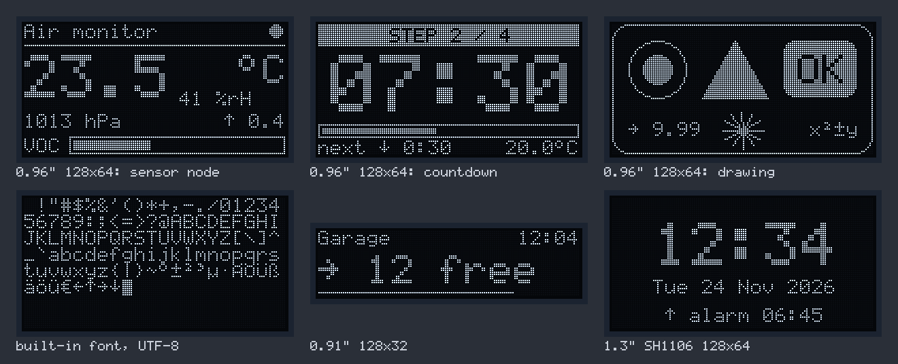

# ssd1306-oled

A driver for the small monochrome OLED modules with an **SSD1306** or **SH1106** controller:
the 0.96" 128x64, the 0.91" 128x32, the 1.3" 128x64 (SH1106) and the tiny 64x48 / 72x40 /
64x32 / 96x16 panels, over **I2C** or **4-wire SPI**.



*Sample screens rendered by the driver itself, through the fake controller in `tests/`
(`make docs`). The values are made up.*

- **Sends only what changed.** Every drawing call marks the columns it touched. `display()`
  then sends just those bytes of each page. With the optional shadow buffer it only sends bytes
  that really differ, so the usual loop "clear, draw the whole screen, display" costs a few
  dozen bytes instead of 1 KiB when one digit changes.
- **Text in UTF-8, with its own 5x7 font:** ASCII plus ° ± ² ³ µ · Ä Ö Ü ß ä ö ü € ← ↑ → ↓ █.
  Characters it doesn't know are shown as `?`. It supports scale 1..8, left/centre/right
  alignment, wrapping and a background colour.
- **Drawing:** pixels, lines, rectangles, rounded rectangles, circles and triangles (outline and
  filled), bitmaps and bar gauges. Shapes are clipped at the panel edge. Each pixel is drawn
  exactly once, so `SSD1306_INVERSE` works on every shape.
- **Controller features:** rotation by 180°, contrast, hardware inversion, on/off and hardware
  scroll (SSD1306 only).
- **Portable C99 core** with no Arduino headers, no `malloc` and no `float`. You pass two
  callbacks, so it runs on the Arduino cores, pico-sdk, ESP-IDF or a Linux `i2c-dev`.
- **Precompiled** for ESP8266, ESP32, RP2040, ATmega328P and ATmega2560. Only the thin Arduino
  adapter is compiled with your core.

## Supported platforms

| Target (`.a` folder) | Boards | Built with | Checked against (real firmware in CI) |
|---|---|---|---|
| `esp8266` | Wemos/LOLIN D1 mini, NodeMCU, ESP-01 | xtensa-lx106-elf GCC 10.3 | Arduino ESP8266 core 3.1.2 (`d1_mini`) |
| `esp32` | ESP32 DevKit, ESP32-CAM, WROOM/WROVER | xtensa-esp32-elf GCC 8.4 | Arduino ESP32 core 3.3.13 (`esp32`); built with the 2.0.17 compiler, so it links with 2.0.x too |
| `cortex-m0plus` | Raspberry Pi Pico, Pico W (RP2040) | Arm GNU Toolchain 13.2 | arduino-pico 6.4.0 (`rpipicow`); also usable with pico-sdk and Arduino mbed |
| `atmega328p` | Uno, Nano, Pro Mini | avr-gcc 7.3 | Arduino AVR core 1.8.6 (`uno`) |
| `atmega2560` | Mega 2560 | avr-gcc 7.3 | Arduino AVR core 1.8.6 (`mega`) |
| `linux-x86_64` | PC tools, tests | GCC | host tests with ASan/UBSan |

The core uses about 6 KB of flash on the RP2040 and up to 9.5 KB on AVR if you use everything.
Unused functions are dropped by the linker. RAM use is one framebuffer (width x height / 8 bytes,
so 1 KiB for 128x64), plus the optional shadow buffer of the same size. The shadow is on by
default except on AVR.

ESP32-S2/S3/C3/C6 and RP2350 aren't packaged yet. The C core builds on them unchanged.

## Wiring (I2C module)

| Module | D1 mini | ESP32 | Pico / Pico W | Uno / Nano |
|---|---|---|---|---|
| GND | G | GND | GND | GND |
| VCC (3.3-5 V) | 3V3 | 3V3 | 3V3(OUT) | 5V |
| SCL | D1 | GPIO 22 | GP5 | A5 |
| SDA | D2 | GPIO 21 | GP4 | A4 |

Most modules have pull-ups and a 3.3 V regulator on board. The I2C address is **0x3C**. The
solder jumper printed "0x78/0x7A" on the back selects 0x3C/0x3D (those are the 8-bit forms).
Check the pin order on your module, because some boards swap GND and VCC.

## Arduino

Download `Ssd1306Oled-<version>-arduino.zip` from the
[releases](https://github.com/r4d1um/ssd1306-oled/releases). Then use *Sketch → Include
Library → Add .ZIP Library*, or `arduino-cli lib install --zip-path Ssd1306Oled-*.zip`
(with `library.enable_unsafe_install` set).

```cpp
#include <Ssd1306Oled.h>

Ssd1306Oled oled;                 // 128x64 SSD1306
// Ssd1306Oled oled(128, 32);     // 0.91"
// Ssd1306Oled oled(128, 64, SSD1306_CTRL_SH1106);   // most 1.3" modules

void setup() {
  if (!oled.begin()) {            // Wire, 0x3C, 400 kHz; false = nothing answers
    // try oled.begin(SSD1306_I2C_ADDR_ALT)
  }
  oled.setTextSize(2);
  oled.println("23.5 °C");
  oled.drawRoundRect(0, 40, 128, 24, 6);
  oled.display();                 // sends what changed
}

void loop() {}
```

Other I2C pins: call `Wire.begin(sda, scl)` yourself, then `oled.begin(0x3C, Wire, false)`.
SPI modules: `oled.beginSPI(cs, dc, rst)`, using the hardware SPI pins for SCK (D0) and
MOSI (D1).

| | |
|---|---|
| Display | `display()`, `displayAll()`, `clear()`, `fill(c)`, `on()`, `off()`, `setContrast(0..255)`, `invert(b)`, `rotate180(b)`, `scroll(dir, speed)`, `pendingBytes()` |
| Drawing | `drawPixel`, `getPixel`, `drawHLine`, `drawVLine`, `drawLine`, `drawRect`, `fillRect`, `drawRoundRect`, `fillRoundRect`, `drawCircle`, `fillCircle`, `drawTriangle`, `fillTriangle`, `drawBitmap`, `drawBar` |
| Text | everything from `Print` (`print`, `println`, `printf` where the core has it), `setCursor`, `setTextSize(1..8)`, `setTextColor(fg, bg)`, `setTextWrap`, `printAt(x, y, text, SSD1306_LEFT/CENTER/RIGHT)`, `textWidth` |
| Setup | `config()` (external VCC, column offset, ...), `setBuffer(fb)`, `useShadow(bool)`, `core()` for the C API |

Colours: `SSD1306_WHITE`, `SSD1306_BLACK` and `SSD1306_INVERSE`. For text the background can
also be `SSD1306_TRANSPARENT`. The examples are in [`examples/`](examples): *HelloOled*,
*Dashboard* and *SpiOled*.

## pico-sdk, ESP-IDF and other C projects

Download `Ssd1306Oled-<version>-<target>.tar.gz` (`include/` and `lib/libSsd1306Oled.a`),
then link the archive and write the bus callback. For pico-sdk:

```c
#include <string.h>
#include "hardware/i2c.h"
#include "ssd1306.h"
#include "ssd1306_gfx.h"
#include "ssd1306_text.h"

static int oled_write(void *ctx, uint8_t data, const uint8_t *buf, size_t len) {
    uint8_t tx[1 + 128];                        // control byte + up to 128 bytes
    tx[0] = data ? 0x40 : 0x00;
    memcpy(tx + 1, buf, len);
    return i2c_write_blocking(i2c0, SSD1306_I2C_ADDR, tx, len + 1, false) == (int)(len + 1) ? 0 : 1;
}

static uint8_t fb[SSD1306_FB_BYTES(128, 64)];
static ssd1306 oled;

void oled_start(void) {
    ssd1306_bus bus = { oled_write, NULL, NULL, 128 };   // max 128 bytes per write
    ssd1306_config cfg;
    ssd1306_default_config(&cfg, 128, 64);
    ssd1306_init(&oled, &bus, &cfg, fb);
    ssd1306_print_at(&oled, 64, 28, SSD1306_CENTER, "Hello Pico");
    ssd1306_flush(&oled);
}
```

```cmake
add_library(ssd1306 STATIC IMPORTED)
set_target_properties(ssd1306 PROPERTIES
    IMPORTED_LOCATION ${CMAKE_CURRENT_LIST_DIR}/Ssd1306Oled/lib/libSsd1306Oled.a
    INTERFACE_INCLUDE_DIRECTORIES ${CMAKE_CURRENT_LIST_DIR}/Ssd1306Oled/include)
target_link_libraries(app pico_stdlib hardware_i2c ssd1306)
```

For SPI, set D/C from the `data` argument and send the bytes as they are. The headers describe
every function: [`ssd1306.h`](src/ssd1306.h) (controller, flushing, shadow),
[`ssd1306_gfx.h`](src/ssd1306_gfx.h) and [`ssd1306_text.h`](src/ssd1306_text.h). On errors,
`ssd1306_init` returns -1 for an unsupported size, or the non-zero value of your write callback.
`ssd1306_flush` keeps unsent pages dirty, so the next flush retries them.

## Building and testing

```sh
make test             # host tests against the fake SSD1306/SH1106 (ASan + UBSan)
make dist             # the core for every target (needs the cross compilers, see below)
make package          # release packages in build/pkg/
make firmware-check   # real firmware for Uno, Mega, D1 mini, ESP32 and Pico W (arduino-cli)
make screens          # PNG screenshots of sample screens in build/screens/
make font             # src/ssd1306_font5x7.c from tools/font/font5x7.txt
```

Cross compilers: `tools/toolchains.sh` (ESP, pinned and SHA-256 checked), `apt install gcc-avr
avr-libc` and the Arm GNU Toolchain. CI ([`.github/workflows/ci.yml`](.github/workflows/ci.yml))
does all of the above on every pull request and publishes release `v<version>` when the version in
`library.properties` is raised. The fake controller in
[`tests/fake_ssd1306.h`](tests/fake_ssd1306.h) interprets the command stream like the real
chips, including addressing modes, segment remap, COM scan direction and the SH1106's
132-column RAM.

## Disclaimer

This is a hobby project, provided as is without any warranty (see [LICENSE](LICENSE)). It drives
display hardware. Wrong wiring, supply voltage or controller settings, such as external VCC on
a module with a charge pump, can damage the display or the board. You use it at your own risk.

## License

MIT, see [LICENSE](LICENSE). The font in `tools/font/font5x7.txt` is this project's own design
and is under the same license.
